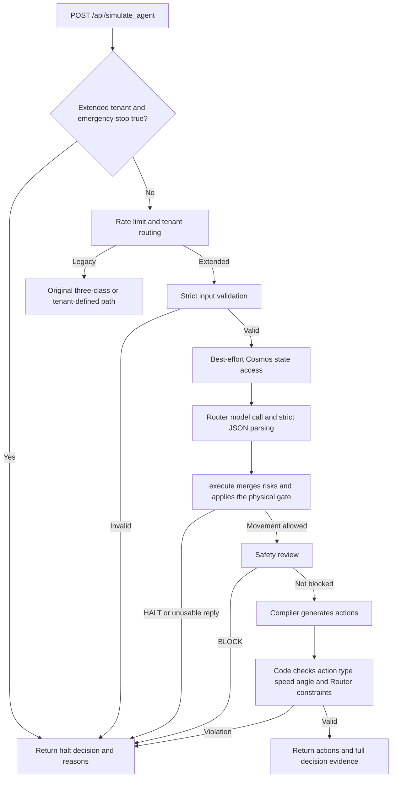

# Project OmniGuard

Cloud-edge AGV simulation and AI state-routing evaluation: investigating cloud-model waiting time and the division between model predictions and code-enforced action constraints.

OmniGuard combines a simulated AGV dashboard, a three-stage cloud agent pipeline, Azure infrastructure templates, and reproducible benchmark archives. It is a research and engineering demonstrator, not a certified robot-control product.

[中文说明](README_zh.md) · [Architecture](ARCHITECTURE.md) · [Documentation](docs/README.md) · [Evidence policy](docs/evidence/README.md) · [Router evaluation report](eval/report.md) · [Router evidence index](eval/EVIDENCE_INDEX.md) · [Evaluation directory guide](eval/README.md)

## Start here

| Question | Read |
|---|---|
| What connects to what? | Extended-path diagram below → [Azure reference diagrams](docs/architecture/README.md) |
| What is done and what is not? | [Project status](docs/STATUS.md) |
| What was measured? | [Formal evaluation](eval/report.md); [timing evidence](eval/LATENCY_EVIDENCE.md) for latency |
| Why these choices, and at what cost? | [Three design trade-offs](ARCHITECTURE.md#design-tradeoffs) |
| Where is the implementation? | [Code map, Chinese](docs/guide/BACKEND_CODE_GUIDE_zh.md) → [model adapter and action validation](src/cloud-orchestrator/router_v2/pipeline.py) → [risk synthesis](src/cloud-orchestrator/router_v2/rules.py) → [HTTP tests](tests/test_extended_endpoint.py) |
| What can I check without a key? | [Free offline walkthrough](eval/REPRODUCE.md#level-1-offline-walkthrough-free): code behavior and published-file integrity |

For an interactive example, start the frontend locally and open `/dashboard/theorem`; change the configured latency and speed to observe simulated motion. `/dashboard/live` also needs a configured backend and may incur model-call charges when started. Neither browser view is a robot experiment or a reproduction of the formal six-class Router results.

## What this repository contains

| Area | Role | Status |
|---|---|---|
| AGV dashboard | Simulates cloud-only, cloud+edge, and token-heavy control loops | Core demonstrator |
| Embodied-brain pipeline | Router → safety → action compiler with early exit | Core research implementation |
| Azure IaC | Frozen Bicep snapshot and deployment scripts for the reference topology (generated with the separate Bicep Studio project) | Engineering reference |
| Benchmark archive | Immutable historical and diagnostic runs with limitations | Evidence (historical background) |
| State-routing evaluation (`eval/`) | Six-class specification, frozen synthetic test set, real-model runs, rule controls, stress cases | Evidence for the new router |

The repository deliberately distinguishes implemented behavior, simulated parameters, measured results, and future proposals. See the [evidence policy](docs/evidence/README.md) before quoting a number.

## Request flow: extended six-class HTTP path



In the extended path, emergency stop and input validation precede external calls; the HP≤0 or battery<5% gate is applied by `execute()` after the Router returns. The legacy path has a pre-model physical check. Rate limiting may return 429. A returned halt decision does not establish that motion stopped while waiting or that a physical brake operated. Real-model evaluation covers the Router/decision function; complete HTTP tests use fake dependencies.

## Architecture diagrams

The Azure reference design is drawn three ways in [docs/architecture](docs/architecture/README.md): the restored thesis Figure 3.1 (system architecture) and Figure 3.2 (pipeline sequence), and a topology diagram drawn from the Bicep snapshot, with notes on where the thesis figure differs from the snapshot. The cloud environment was deployed once for the thesis and has been torn down.

## State routing and its evaluation

The Router stage has an extended, opt-in form with **six telemetry-state routes**: `CRITICAL_OBSTACLE`, `OVERHEAT`, `LOW_HEALTH`, `LOW_BATTERY`, `OVERSPEED`, `NORMAL_NAV`, plus an optional operator note that reports a person or obstacle ahead. It is state recognition and routing for a simulated AGV, not chat-style intent recognition. Every threshold, priority and action is an experimental convention of the simulation, not a standard or field data ([specification](eval/spec/LABEL_SPEC.md)).

How one decision is made: code checks the input first (a missing, out-of-range or over-long input is a HALT that never reaches a model); the model answers with one strict JSON object (route and note status); code adds every telemetry risk the model did not name, applies the physical gate and resolves **one** motion state. The separate emergency-stop flag is handled at the HTTP entry. When halted, charging and a speed cap on resumption remain deferred metadata; when movement is allowed, low battery can set a charger goal and overspeed imposes a current speed cap. A model reply cannot lift a telemetry risk the code has found or the emergency stop; a risk that comes only from the note can still be missed if the model misreads it. An unusable Router reply returns a halt decision.

**Scope of the new route.** Only the opt-in tenant `Tenant-Alpha-Extended` (`router_mode: extended`) uses it, in the HTTP simulator endpoint. The original tenants, their prompts and the IoT Hub path are unchanged. `goal: CHARGER` is a structured goal; nothing checks that a vehicle reaches the charger.

### What each kind of evidence shows

| Evidence | What it shows | What it does not show |
|---|---|---|
| Browser dashboard | Latency and clearance dynamics under configured parameters | Anything measured on a robot |
| Real-model Router evaluation ([report](eval/report.md)) | Prompt B-1.0 on 300 frozen synthetic records and 55 stress cases, scored against rules written in the specification | Production accuracy, generalisation, robot safety |
| HTTP flow with fake dependencies (`tests/test_extended_endpoint.py`) | The endpoint keeps the evaluation's constraints through Safety and Compiler: input check, emergency stop, action contract, Router retries off | A run of the endpoint against a real model |
| Rule controls R1 / R2 | What fixed keyword rules do on the same records | An optimised-versus-baseline improvement |

### Formal result (tag `eval-formal-v1`, frozen data `acceptance-v1`)

| | Result |
|---|---|
| Test set | 300 synthetic test records authored separately from the dev material, 50 per class, in **34 families** (not 300 independent scenarios); 72 carry an operator note. Labels are AI annotation with AI review, not expert truth. Inputs stay private; only hashes and counts are public |
| Baseline B-1.0, two independent runs | each **300/300** correct, macro-F1 1.0, note status 72/72 each, no provider error, agreement between the runs 100 %. Record-level 95 % Wilson interval 98.74 %-100 % (not corrected for the 34 families) |
| Rule controls on the same records | R1 281/300 (macro-F1 0.936, 14 missed halts, 3 needless), R2 280/300 (0.935, 10 missed, 6 needless); note status 23/72 and 15/72 |
| Stress, 55 cases | 32 requests to the model, 13 invalid inputs rejected in code, 10 injected faults checked offline; no missed halt, needless halt or model error observed |
| Programme | 634 API requests, 630,792 tokens, about US$0.285 at the configured rates (an estimate, not a bill) |

These numbers describe this synthetic data under this specification. They are not a production accuracy, not a safety certification, and **not an improvement**: there is no optimised version, so no before / after figure exists. The model version is the owner's statement and is not verified; the request carries `temperature=0` but the provider's reasoning mode ignores it. Not done yet: a stranger's reproduction and the owner's oral acceptance. See the [limitations](eval/LIMITATIONS.md), the [evidence index](eval/EVIDENCE_INDEX.md) and [how to reproduce](eval/REPRODUCE.md).

## Historical benchmark evidence (2026-07 and 2026-08, background only)

These two preserved runs predate the state-routing work. They used the original three labels, a different scenario generator and, for the 60-run, an unknown model, so **they are not the start of any "before / after" comparison with the results above**. They serve different purposes:

| Run | Scenarios | Router accuracy | Critical recall | Early exit | Sum of three model-call durations, full-flow cases only |
|---|---:|---:|---:|---:|---|
| Historical thesis run, 2026-07-16 | 200 | 94.19% on 172 parseable router outputs | Not recoverable from the preserved summary | 39.5% | n=121; mean 6.174 s |
| Diagnostic run, 2026-08-18 | 60 | 90.38% on 52 parseable router outputs | 9/14 under the legacy 5–50 cm label; all 8 cases below 30 cm were caught and blocked | 41.67% | n=35; median 7.67 s, mean 16.72 s, max 73.89 s |

These durations cover only full-flow cases and exclude browser-to-application HTTP round trips, proxy and Cosmos processing; they are not end-to-end latency. Communication within each model API call is included in its stage timing. These runs are not directly interchangeable. The diagnostic run exposed a long latency tail and five label-policy disagreements at 31–46 cm; all five still produced a final stop action. It should not be presented as a completed 200-scenario benchmark or as five demonstrated unsafe passes. Full provenance and metric definitions are in the [benchmark results guide](src/cloud-orchestrator/embodied_brain/benchmark_results/README.md).

## Repository layout

```text
.azure/                         Azure Bicep modules and deployment parameters
scripts/                        Provisioning, deployment, validation, and local-start scripts
src/client-edge/                Next.js frontend and browser-side experiments
src/cloud-orchestrator/         FastAPI/Azure Functions backend and agent pipelines
src/cloud-orchestrator/
  embodied_brain/               AGV agent pipeline, scenarios, and benchmark evidence
  router_v2/                    Extended six-route decision (opt-in tenant)
eval/                           Specification, datasets, runners, formal results and evidence index
tests/                          Unit, contract, benchmark, and shadow-environment tests
docs/                           Current documentation
```

## Local development

Prerequisites:

- Python 3.10+
- Node.js 20+
- Azure Functions Core Tools for the Functions host workflow
- Provider credentials configured from the supplied example settings

Start the backend and frontend in separate terminals:

```bash
make start-backend
make start-frontend
```

Useful checks:

```bash
make test
python3 -m pytest tests/test_docs_consistency.py -q
```

Azure operations are documented in [docs/operations.md](docs/operations.md). Review the target subscription and parameters before running provisioning or destruction commands.

## Interactive routes

| Route | Purpose | Data source |
|---|---|---|
| `/dashboard` | Three-AGV simulation | Browser simulation |
| `/dashboard/theorem` | Single-AGV latency/clearance sandbox | Browser simulation |
| `/dashboard/compare` | Cloud versus edge comparison | Browser simulation |
| `/dashboard/live` | Calls the configured backend when available | Runtime-dependent |

## Documentation contract

- [docs/README.md](docs/README.md) is the documentation entry point.
- [ARCHITECTURE.md](ARCHITECTURE.md) describes the current system and its boundaries.
- [docs/evidence/README.md](docs/evidence/README.md) defines which claims are measured, simulated, configured, or planned.
- [docs/adrs/INDEX.md](docs/adrs/INDEX.md) records architecture decisions.

## Known limitations

- AGV behavior is simulated; no physical robot was controlled by these experiments.
- LLM latency and classification results depend on provider, model, region, and run conditions.
- The historical 200-run summary does not retain every metric needed for modern safety analysis.
- The 60-run diagnostic archive does not record a trustworthy model identifier.
- WebGPU and brake-latency demonstrations are not safety certification evidence.
- The state-routing results come from synthetic data written under the project's own specification; 300 records are 34 families. They are not production accuracy and the model version is unverified.
- The new route has not been run through the HTTP endpoint against a real model; a third-party reproduction needs the private test data (see [reproduction](eval/REPRODUCE.md)).

## License

[MIT](LICENSE)
