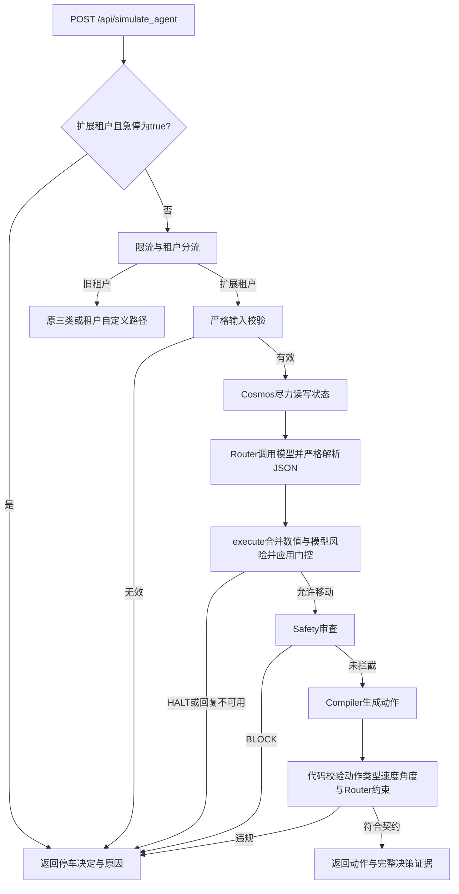

# Project OmniGuard

云边协同 AGV 仿真与 AI 状态路由评测项目，研究等待云端模型的时间代价，以及模型判断与代码动作约束的分工。

OmniGuard 包含模拟 AGV 仪表盘、三级云端 Agent 流水线、Azure 基础设施模板和可追溯的 benchmark 结果。它是研究与工程验证项目，不是经过安全认证的实体机器人控制产品。

[English](README.md) · [系统架构](ARCHITECTURE.md) · [文档入口](docs/README.md) · [证据规则](docs/evidence/README.md) · [路由评测报告](eval/report.md) · [路由证据索引](eval/EVIDENCE_INDEX.md) · [评测目录导航](eval/README.md)

## 从这里看项目

| 想了解什么 | 推荐入口 |
|---|---|
| 整体方案与调用顺序 | 下方扩展路径流程图 → [Azure参考架构图](docs/architecture/README.md) |
| 做到哪一步、哪些没做 | [项目现状](docs/STATUS.md)（英文） |
| 实际测出了什么 | [正式评测报告](eval/report.md)；耗时另看[延迟证据](eval/LATENCY_EVIDENCE.md) |
| 为什么这样设计，有哪些代价 | [三个关键设计取舍](ARCHITECTURE.md#design-tradeoffs) |
| 核心代码是否落实 | [代码地图](docs/guide/BACKEND_CODE_GUIDE_zh.md) → [模型调用与动作校验](src/cloud-orchestrator/router_v2/pipeline.py) → [风险合成](src/cloud-orchestrator/router_v2/rules.py) → [HTTP端点测试](tests/test_extended_endpoint.py) |
| 不用密钥能验证什么 | [免费离线复现](eval/REPRODUCE.md#level-1-offline-walkthrough-free)；只验证代码流程与结果文件完整性 |

想直观看行为：本地启动前端后打开 `/dashboard/theorem`，改变延迟和速度，观察仿真运动；`/dashboard/live` 另需后端配置，开始运行可能产生模型调用费用。沙盒不是实体车实验，浏览器演示也不等于正式六类Router评测。

## 仓库包含什么

| 区域 | 作用 | 定位 |
|---|---|---|
| AGV Dashboard | 模拟纯云端、云+边缘、长 Token 控制回路 | 核心演示 |
| Embodied Brain | Router → Safety → Compiler，支持提前退出 | 核心研究实现 |
| Azure IaC | Bicep 模板和部署脚本 | 工程参考 |
| Benchmark Archive | 保存历史跑次、诊断跑次及局限 | 实验证据（历史背景） |
| 状态路由评测（`eval/`） | 六类规范、冻结合成测试集、真实模型运行、规则对照、压力用例 | 新路由的证据 |

本仓库明确区分已实现行为、模拟参数、实测结果和未来方案。引用数字前请先阅读[证据规则](docs/evidence/README.md)。

## 系统流程：六类扩展 HTTP 路径



扩展路径中，急停与输入校验在外部调用前处理；HP≤0或电量<5%的物理门控在Router返回后由 `execute()` 应用。旧路径有模型前物理预检查，不能把两者混画。限流可能返回429；图中的停车是后端返回决定，不证明等待期间车辆已停下或实物已制动。真实模型评测主要覆盖Router／决策函数，完整HTTP流程使用假依赖测试。

## 架构图

Azure 参考方案在 [docs/architecture](docs/architecture/README.md) 里有三张图：恢复的论文图 3.1（系统架构）和图 3.2（流水线时序），以及按 Bicep 快照绘制的拓扑图，并说明论文图和快照的差异。云环境为论文部署过一次，现已拆除。

## 状态路由及其评测

Router 阶段有一个可选的扩展形态，共 **6 类遥测状态路由**：`CRITICAL_OBSTACLE`、`OVERHEAT`、`LOW_HEALTH`、`LOW_BATTERY`、`OVERSPEED`、`NORMAL_NAV`，另可附带一条操作员备注（报告前方有人或障碍）。它是对模拟 AGV 的状态识别与处置路由，不是聊天式的意图识别。所有阈值、优先级和动作都是本仿真的实验约定，不是行业标准或现场数据（见[规范](eval/spec/LABEL_SPEC.md)）。

一次决策怎么做：代码先检查输入（缺失、越界或过长的输入直接 HALT，不会到达模型）；模型只返回一个严格的 JSON（路由和备注状态）；代码补上模型没点名的遥测风险，合并风险并应用物理门控，合成**唯一**的运动状态。独立急停标志在HTTP入口前置处理。需要停车时，回充与恢复后的限速只保留为待办；允许移动时，低电量可设置充电目标，超速会形成当前限速约束。模型回复不能解除代码识别出的遥测风险和急停限制；仅来自备注的风险仍可能因模型误判而漏停。无法使用的Router回复返回停车决定。

**新路由的适用范围。** 只有可选租户 `Tenant-Alpha-Extended`（`router_mode: extended`）在 HTTP 模拟端点里使用它；原来的租户、它们的提示词和 IoT Hub 旧路径都没有改动。`goal: CHARGER` 只是结构化目标，代码不检查车辆是否到达充电位。

### 每类证据证明什么

| 证据 | 证明什么 | 不证明什么 |
|---|---|---|
| 浏览器 Dashboard | 在配置参数下的时延与安全距离动态 | 任何实体机器人上的实测 |
| 真实模型 Router 评测（[报告](eval/report.md)） | 提示词 B-1.0 在 300 条冻结合成记录和 55 个压力用例上，对照规范里写明的规则 | 生产准确率、泛化能力、机器人安全 |
| 假依赖下的 HTTP 流程（`tests/test_extended_endpoint.py`） | 端点在 Safety 和 Compiler 之后仍保留评测的约束：输入检查、急停、动作契约、Router关闭重试 | 端点对真实模型的运行 |
| 规则对照 R1 / R2 | 固定关键词规则在同一批记录上的表现 | 优化版相对基线的提升 |

### 正式结果（标签 `eval-formal-v1`，冻结数据 `acceptance-v1`）

| | 结果 |
|---|---|
| 测试集 | 300 条合成测试记录，独立于开发材料制作，每类 50 条，来自 **34 个家族**（不是 300 个独立场景）；72 条带备注。标签为 AI 标注加 AI 复核，不是专家金标。输入保持私有，仓库只公开哈希和数量 |
| 基线 B-1.0，两次独立运行 | 每次 **300/300** 正确，macro-F1 为 1.0，备注状态各 72/72，无接口错误，两次一致率 100%。按记录计的 95% Wilson 区间 98.74%–100%（未按 34 个家族校正） |
| 同一批记录上的规则对照 | R1 281/300（macro-F1 0.936，漏停 14，误停 3），R2 280/300（0.935，漏停 10，误停 6）；备注状态 23/72 和 15/72 |
| 压力集 55 例 | 32 次请求发给模型，13 个非法输入在代码里拒绝，10 个注入故障离线验证；未观察到漏停、误停或模型错误 |
| 总用量 | 634 次 API 请求，630,792 token，按配置费率约 US$0.285（估算，不是账单） |

这些数字只描述这批合成数据在本规范下的表现：不是生产准确率，不是安全认证，也**不是提升**——没有制作优化版，所以不存在前后对比的数字。模型版本由所有者声明，未验证；请求带 `temperature=0`，但提供方的推理模式会忽略它。尚未完成：陌生人复现和所有者的口述验收。详见[局限](eval/LIMITATIONS.md)、[证据索引](eval/EVIDENCE_INDEX.md)和[复现说明](eval/REPRODUCE.md)。

## 历史 benchmark 证据（2026-07、2026-08，仅作背景）

这两个跑次早于状态路由工作：用的是原来的三类标签、不同的场景生成器，60 条跑次还缺模型名称，所以**它们不是上文结果的“前”，不能与之组成任何前后对比**。

| 跑次 | 场景数 | Router 准确率 | Critical 召回 | 提前退出率 | 完整流程场景的三段模型调用耗时之和 |
|---|---:|---:|---:|---:|---|
| 2026-07-16 历史论文跑次 | 200 | 172 条可解析输出中 94.19% | 现有摘要无法恢复 | 39.5% | n=121；均值 6.174 秒 |
| 2026-08-18 诊断跑次 | 60 | 52 条可解析输出中 90.38% | 旧 5–50 cm 标签口径下为 9/14；低于 30 cm 的 8 条全部识别并阻断 | 41.67% | n=35；中位数 7.67 秒，均值 16.72 秒，最大 73.89 秒 |

这些耗时只统计走完全流程的场景，不含浏览器到业务后端的HTTP往返、代理或Cosmos耗时；不是端到端时延。模型API调用自身的通信耗时包含在阶段计时中。两个跑次不能混用。60 条诊断跑次暴露了长尾时延，以及 31–46 cm 区间内的 5 个标签/策略口径分歧；这 5 条的 Compiler 最终都输出了 stop，不能写成 5 个危险动作被放行。该跑次也不能描述成已经完成的 200 场景 benchmark。详细来源和指标定义见 [benchmark results guide](src/cloud-orchestrator/embodied_brain/benchmark_results/README.md)。

## 目录结构

```text
.azure/                         Azure Bicep 模块和部署参数
scripts/                        部署、校验与本地启动脚本
src/client-edge/                Next.js 前端和浏览器实验
src/cloud-orchestrator/         FastAPI/Azure Functions 后端与 Agent 流水线
src/cloud-orchestrator/
  embodied_brain/               AGV Agent、场景协议与 benchmark 证据
  router_v2/                    扩展的六类路由决策（可选租户）
eval/                           规范、数据集、运行器、正式结果与证据索引
tests/                          单元、契约、benchmark 与影子环境测试
docs/                           当前文档与历史归档
```

## 本地运行

前置条件：Python 3.10+、Node.js 20+；使用 Functions Host 时还需要 Azure Functions Core Tools。

在两个终端分别运行：

```bash
make start-backend
make start-frontend
```

常用检查：

```bash
make test
python3 -m pytest tests/test_docs_consistency.py -q
```

Azure 操作见 [docs/operations.md](docs/operations.md)。执行部署或销毁前必须检查订阅和参数。

## 页面路由

| 路由 | 作用 | 数据来源 |
|---|---|---|
| `/dashboard` | 三 AGV 仿真 | 浏览器模拟 |
| `/dashboard/theorem` | 单 AGV 时延/安全距离沙盒 | 浏览器模拟 |
| `/dashboard/compare` | 云端与边缘并排比较 | 浏览器模拟 |
| `/dashboard/live` | 后端可用时发起真实请求 | 取决于运行环境 |

## 文档规则

- [docs/README.md](docs/README.md) 是唯一文档入口。
- [ARCHITECTURE.md](ARCHITECTURE.md) 只描述当前系统和边界。
- [docs/evidence/README.md](docs/evidence/README.md) 管理实测、模拟、配置和计划类结论。
- [docs/adrs/INDEX.md](docs/adrs/INDEX.md) 记录架构决策。

## 已知限制

- AGV 为模拟对象，没有控制实体机器人。
- LLM 结果受 provider、模型、区域和运行条件影响。
- 历史 200 跑次没有保存现代安全分析所需的全部指标。
- 60 跑次没有可靠记录模型名称。
- WebGPU 和刹车时延演示不构成安全认证证据。
- 状态路由的结果来自按项目自己的规范编写的合成数据，300 条记录属于 34 个家族；不是生产准确率，模型版本未验证。
- 新路由还没有通过 HTTP 端点对真实模型运行；第三方复现需要私有测试数据（见[复现说明](eval/REPRODUCE.md)）。

## License

[MIT](LICENSE)
