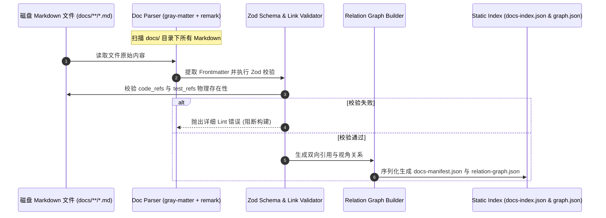

# Project-OmniGuard AI-Native 多维标签化与在线多方向文档系统
## 架构总设计、工程实现、自动化测试与验收全景规范 (Master Blueprint & Agent Execution Spec)

> **文档版本**: `v1.0.0-PROD-SPEC`  
> **制定角色**: 首席系统架构师 / 总设计师 (Chief System Architect)  
> **目标执行者**: Autonomous Coding Agent / 执行工程师  
> **适用基线**: Project-OmniGuard (Azure Serverless/ACA + WebGPU + 3-Agent Orchestrator)  
> **生效时间**: 2026-08-15  

---

## 目录 (Table of Contents)

1. [执行者指南与全局协议 (Agent Execution Protocol)](#1-执行者指南与全局协议-agent-execution-protocol)
2. [Phase 1: 历史论文与学术资产物理隔离方案](#phase-1-历史论文与学术资产物理隔离方案)
3. [Phase 2: 多维元数据分类体系与 Schema 规范](#phase-2-多维元数据分类体系与-schema-规范)
4. [Phase 3: 核心解析、图谱构建与索引引擎设计](#phase-3-核心解析图谱构建与索引引擎设计)
5. [Phase 4: 多方向在线文档门户 (Web Portal) 架构与组件设计](#phase-4-多方向在线文档门户-web-portal-架构与组件设计)
6. [Phase 5: 自动化测试与 CI/CD 质量守门体系](#phase-5-自动化测试与-cicd-质量守门体系)
7. [Phase 6: 执行 Agent 原子级分步工单 (Step-by-Step Task Breakdown)](#phase-6-执行-agent-原子级分步工单-step-by-step-task-breakdown)
8. [Phase 7: 最终验收标准 (Definition of Done & Quality Gates)](#phase-7-最终验收标准-definition-of-done--quality-gates)

---

## 1. 执行者指南与全局协议 (Agent Execution Protocol)

### 1.1 背景与核心任务
`Project-OmniGuard` 经历学术论文科研、实验基准测试（Kinematic-Token Theorem）及企业级云原生演进，目前沉淀了 34 篇 ADR、24 篇云架构蓝图、数万条压测数据和多篇论文草稿。传统单继承树状目录已无法满足不同受众（学术评审、云架构师、前端工程师、合规官）的高效阅读。

**本项目的核心交付物**：
1. **彻底净化工程仓库**：将全部论文、答辩、实验压测产物安全迁移至外部归档目录。
2. **构建多维标签系统**：为仓库内所有保留文档注入标准化 YAML Frontmatter。
3. **实现多方向文档引擎与在线门户**：在 `src/client-edge` 前端中构建具备 **4 大视角切片（学术科研、云架构 IaC、前端边缘计算、合规审计）** 的动态在线文档系统。

### 1.2 执行 AI 的行为准则 (Strict Execution Rules)
- **准则 1 (不可逆破坏防护)**：物理迁移文件前，必须先校验源文件存在且有备份，严禁执行 `rm -rf` 盲删。
- **准则 2 (代码引用的强一致性)**：Frontmatter 中的 `code_references` 与 `tests` 必须在当前代码库中真实存在，必须通过自动化校验脚本（Dead Link / Reference Checker）。
- **准则 3 (前后端分层与无毒侵入)**：文档系统的元数据解析器必须支持静态编译期生成（SSG），避免在生产运行时引入沉重的 AST 解析开销。

---

## Phase 1: 历史论文与学术资产物理隔离方案

### 1.1 资产分类与目标归档路径
所有迁移资产统一移出至仓库根目录同级的 `../Project-OmniGuard-Paper-Archive/`。

```
../Project-OmniGuard-Paper-Archive/
├── manuscripts/                 # 论文草稿与写作过程文件
│   ├── thesis_draft.md
│   ├── AI_Safety_Research_Work_Sample.md
│   ├── FRONTEND_DASHBOARD_KINEMATIC_EVALUATION.md
│   └── paper/ (original.txt, new.txt, a.txt)
├── presentations/               # 答辩 PPT 与演示指南
│   ├── midterm_presentation.pptx
│   ├── midterm_presentation_en.pptx
│   └── midterm_demo_guide.md
├── figures/                     # 论文专属高分辨率插图 (11张)
│   ├── 4.1_phase1_trace.png
│   ├── 4.2_sensor_misclass.png
│   ├── 5.1 Per-Stage Box Plot.png ~ 5.7_webgpu_benchmark.png
│   ├── fig3.2_sequence.png / fig3.2_sequence.puml
│   └── architecture-figure-3.1.png
├── benchmarks/                  # 实验基准数据集与分析 Notebook
│   ├── benchmark_200_20260716_v2/
│   ├── benchmark_webgpu.html
│   └── backend_benchmark_results/
└── journals/                    # 历史演进日记与旧版路线图
    ├── architect-growth-journal-logs/
    └── PROJECT_EVOLUTION_ROADMAP_20260706.md
```

### 1.2 自动化隔离脚本规范 (`scripts/archive-paper-assets.sh`)
执行 Agent 必须编写并运行以下幂等脚本完成迁移：

```bash
#!/usr/bin/env bash
set -euo pipefail

DEST_DIR="../Project-OmniGuard-Paper-Archive"
echo "[1/4] Creating destination archive directory: ${DEST_DIR}..."
mkdir -p "${DEST_DIR}/manuscripts/paper"
mkdir -p "${DEST_DIR}/presentations"
mkdir -p "${DEST_DIR}/figures"
mkdir -p "${DEST_DIR}/benchmarks/backend_benchmark_results"
mkdir -p "${DEST_DIR}/journals"

echo "[2/4] Moving manuscripts and presentation files..."
[ -f "docs/thesis_draft.md" ] && mv "docs/thesis_draft.md" "${DEST_DIR}/manuscripts/"
[ -f "docs/AI_Safety_Research_Work_Sample.md" ] && mv "docs/AI_Safety_Research_Work_Sample.md" "${DEST_DIR}/manuscripts/"
[ -f "FRONTEND_DASHBOARD_KINEMATIC_EVALUATION.md" ] && mv "FRONTEND_DASHBOARD_KINEMATIC_EVALUATION.md" "${DEST_DIR}/manuscripts/"
[ -d "docs/research_paper/paper" ] && mv docs/research_paper/paper/* "${DEST_DIR}/manuscripts/paper/"
[ -f "docs/research_paper/a.txt" ] && mv "docs/research_paper/a.txt" "${DEST_DIR}/manuscripts/"
[ -f "docs/research_paper/midterm_demo_guide.md" ] && mv "docs/research_paper/midterm_demo_guide.md" "${DEST_DIR}/presentations/"
[ -f "docs/research_paper/midterm_presentation.pptx" ] && mv "docs/research_paper/midterm_presentation.pptx" "${DEST_DIR}/presentations/"
[ -f "docs/research_paper/midterm_presentation_en.pptx" ] && mv "docs/research_paper/midterm_presentation_en.pptx" "${DEST_DIR}/presentations/"

echo "[3/4] Moving figures and benchmarks..."
find docs/research_paper -maxdepth 1 -name "*.png" -o -name "*.puml" | while read -r file; do
    mv "$file" "${DEST_DIR}/figures/"
done
[ -d "docs/experiment_results" ] && mv "docs/experiment_results" "${DEST_DIR}/benchmarks/"
[ -f "src/client-edge/benchmark_webgpu.html" ] && mv "src/client-edge/benchmark_webgpu.html" "${DEST_DIR}/benchmarks/"
[ -d "src/cloud-orchestrator/embodied_brain/benchmark_results" ] && mv src/cloud-orchestrator/embodied_brain/benchmark_results/* "${DEST_DIR}/benchmarks/backend_benchmark_results/" && rm -rf src/cloud-orchestrator/embodied_brain/benchmark_results

echo "[4/4] Moving journals and obsolete plans..."
[ -d "docs/logs/architect-growth-journal-logs" ] && mv "docs/logs/architect-growth-journal-logs" "${DEST_DIR}/journals/"
[ -f "docs/PROJECT_EVOLUTION_ROADMAP_20260706.md" ] && mv "docs/PROJECT_EVOLUTION_ROADMAP_20260706.md" "${DEST_DIR}/journals/"

# 清理空目录
[ -d "docs/research_paper" ] && rmdir docs/research_paper || true
[ -d "docs/logs" ] && rmdir docs/logs || true

echo "✅ Quarantine completed successfully. Archive preserved at: ${DEST_DIR}"
```

### 1.3 净化后的标准文档目录结构
清理后，`docs/` 目录将完全服务于生产工程与系统演进：
```
docs/
├── adrs/                   # 架构决策记录 (ADR-001 ~ ADR-034)
├── reference/
│   └── blueprints/         # 生产云架构蓝图 (00-azure ~ 24-troubleshooting)
├── dashboard/              # 生产运维/Live大屏使用说明
├── plan/                   # 进行中或未来工程规划
├── tutorials/              # 开发者快速上手与部署手册
├── PROJECT_MEMORY.md       # 项目工程级持久心智地图
└── README.md               # 文档系统总说明
```

---

## Phase 2: 多维元数据分类体系与 Schema 规范

### 2.1 维度定义 (The 6-Dimensional Taxonomy)

| 维度名称 | 字段 Key | 含义说明 | 允许枚举 / 格式 |
| :--- | :--- | :--- | :--- |
| **唯一标识** | `id` | 文档全局唯一编号 | `DOC-[分类]-[序号]` (例: `DOC-ADR-025`, `DOC-BP-13`) |
| **标题与元数据** | `title`, `summary`, `version`, `updated_at` | 文档基础信息 | 字符串 / 日期 |
| **技术领域** | `domains` | 所属核心技术领域 | `cyber-physical-safety`, `multi-agent`, `zero-trust-network`, `edge-inference`, `iac-bicep`, `finops`, `observability`, `iot-telemetry` |
| **受众多方向视角** | `perspectives` | **系统核心多视角** | `academic-research` (学术科研)<br/>`cloud-architecture` (云原生/IaC)<br/>`frontend-engineering` (前端/边缘)<br/>`enterprise-audit` (合规/审计) |
| **系统分层** | `layers` | 涉及的物理/逻辑层级 | `edge-client`, `cloud-orchestrator`, `iac-infra`, `cross-cutting` |
| **文档性质** | `doc_type` | 文档的标准类型 | `adr`, `blueprint`, `specification`, `tutorial`, `playbook`, `theorem` |
| **代码与测试关联** | `code_refs`, `test_refs` | 真实工程文件回溯 | 文件相对路径数组 (必须在 Git 中可寻址) |
| **生命周期状态** | `status` | 方案当前状态 | `draft`, `in-review`, `accepted`, `superseded`, `deprecated` |

### 2.2 标准 YAML Frontmatter 示例
在所有保留文档顶部强制要求遵循如下格式：

```markdown
---
id: "DOC-ADR-025"
title: "Kinematic-Token Theorem Sandbox and Edge Fallback"
summary: "Formalization of the Kinematic-Token safety deadlock and WebGPU SLM fallback architecture."
version: "2.0.0"
updated_at: "2026-08-15"
authors: ["Shengwei Liu"]
domains:
  - "cyber-physical-safety"
  - "edge-inference"
perspectives:
  - "academic-research"
  - "frontend-engineering"
layers:
  - "edge-client"
doc_type: "adr"
status: "accepted"
code_refs:
  - "src/client-edge/src/app/shared/physics/kinematic-token.ts"
  - "src/client-edge/src/app/dashboard/lib/kinematic.ts"
test_refs:
  - "tests/test_brain.py"
---
```

### 2.3 严谨的 TypeScript / Zod 校验 Schema
在 `src/client-edge/src/lib/docs/schema.ts` 中定义类型与校验器：

```typescript
import { z } from 'zod';

export const PerspectiveEnum = z.enum([
  'academic-research',
  'cloud-architecture',
  'frontend-engineering',
  'enterprise-audit',
]);

export const DomainEnum = z.enum([
  'cyber-physical-safety',
  'multi-agent',
  'zero-trust-network',
  'edge-inference',
  'iac-bicep',
  'finops',
  'observability',
  'iot-telemetry',
]);

export const LayerEnum = z.enum([
  'edge-client',
  'cloud-orchestrator',
  'iac-infra',
  'cross-cutting',
]);

export const DocTypeEnum = z.enum([
  'adr',
  'blueprint',
  'specification',
  'tutorial',
  'playbook',
  'theorem',
]);

export const DocStatusEnum = z.enum([
  'draft',
  'in-review',
  'accepted',
  'superseded',
  'deprecated',
]);

export const DocMetadataSchema = z.object({
  id: z.string().regex(/^DOC-[A-Z0-9_-]+$/, "Invalid ID format. Must match DOC-[TYPE]-[NUM]"),
  title: z.string().min(3),
  summary: z.string().min(10),
  version: z.string().default('1.0.0'),
  updated_at: z.string().regex(/^\d{4}-\d{2}-\d{2}$/, "Format must be YYYY-MM-DD"),
  authors: z.array(z.string()).default(['OmniGuard Team']),
  domains: z.array(DomainEnum).min(1),
  perspectives: z.array(PerspectiveEnum).min(1),
  layers: z.array(LayerEnum).min(1),
  doc_type: DocTypeEnum,
  status: DocStatusEnum.default('accepted'),
  code_refs: z.array(z.string()).optional().default([]),
  test_refs: z.array(z.string()).optional().default([]),
});

export type DocMetadata = z.infer<typeof DocMetadataSchema>;

export interface DocItem extends DocMetadata {
  slug: string;
  filePath: string;
  headings: Array<{ depth: number; text: string; slug: string }>;
  wordCount: number;
  readingTimeMinutes: number;
  rawContent?: string;
}
```

---

## Phase 3: 核心解析、图谱构建与索引引擎设计

### 3.1 架构流水线 (Build-time Index Pipeline)



### 3.2 索引生成脚本实现 (`scripts/build-docs-index.ts`)
在工程根目录下编写自动化索引提取脚本：

```typescript
import fs from 'fs';
import path from 'path';
import matter from 'gray-matter';
import { DocMetadataSchema, DocItem } from '../src/client-edge/src/lib/docs/schema';

const DOCS_ROOT = path.resolve(process.cwd(), 'docs');
const OUTPUT_DIR = path.resolve(process.cwd(), 'src/client-edge/src/generated/docs');

interface RelationEdge {
  source: string; // doc id
  target: string; // doc id or file path
  type: 'code_ref' | 'test_ref' | 'same_domain' | 'perspective_cluster';
}

async function scanDocs(dir: string, fileList: string[] = []): Promise<string[]> {
  const entries = fs.readdirSync(dir, { withFileTypes: true });
  for (const entry of entries) {
    const fullPath = path.join(dir, entry.name);
    if (entry.isDirectory()) {
      if (entry.name !== 'node_modules' && !entry.name.startsWith('.')) {
        await scanDocs(fullPath, fileList);
      }
    } else if (entry.isFile() && entry.name.endsWith('.md')) {
      fileList.push(fullPath);
    }
  }
  return fileList;
}

export async function generateDocIndex() {
  console.log('🚀 [Doc Engine] Scanning docs in:', DOCS_ROOT);
  const files = await scanDocs(DOCS_ROOT);
  const docItems: DocItem[] = [];
  const errors: string[] = [];
  const edges: RelationEdge[] = [];

  for (const filePath of files) {
    const relativePath = path.relative(process.cwd(), filePath);
    const fileContent = fs.readFileSync(filePath, 'utf-8');
    const { data, content } = matter(fileContent);

    // 1. Zod 严格校验
    const parseResult = DocMetadataSchema.safeParse(data);
    if (!parseResult.success) {
      errors.push(`❌ [Metadata Error] in ${relativePath}:\n  ${parseResult.error.message}`);
      continue;
    }

    const meta = parseResult.data;

    // 2. 真实代码引用可达性校验 (Dead Reference Prevention)
    for (const ref of meta.code_refs) {
      if (!fs.existsSync(path.resolve(process.cwd(), ref))) {
        errors.push(`⚠️ [Dead Code Ref] ${meta.id} references non-existent file: ${ref}`);
      } else {
        edges.push({ source: meta.id, target: ref, type: 'code_ref' });
      }
    }
    for (const ref of meta.test_refs) {
      if (!fs.existsSync(path.resolve(process.cwd(), ref))) {
        errors.push(`⚠️ [Dead Test Ref] ${meta.id} references non-existent test: ${ref}`);
      } else {
        edges.push({ source: meta.id, target: ref, type: 'test_ref' });
      }
    }

    // 3. 计算字数与阅读时间
    const wordCount = content.trim().length;
    const readingTimeMinutes = Math.max(1, Math.ceil(wordCount / 400));

    docItems.push({
      ...meta,
      slug: relativePath.replace(/^docs\//, '').replace(/\.md$/, ''),
      filePath: relativePath,
      headings: [], // remark 提取
      wordCount,
      readingTimeMinutes,
      rawContent: content,
    });
  }

  if (errors.length > 0) {
    console.error(`\n❌ Found ${errors.length} validation errors:`);
    errors.forEach(e => console.error(e));
    throw new Error('Doc indexing failed due to metadata/reference errors.');
  }

  fs.mkdirSync(OUTPUT_DIR, { recursive: true });
  fs.writeFileSync(path.join(OUTPUT_DIR, 'docs-manifest.json'), JSON.stringify(docItems, null, 2));
  fs.writeFileSync(path.join(OUTPUT_DIR, 'relation-graph.json'), JSON.stringify({ nodes: docItems, edges }, null, 2));

  console.log(`✅ [Doc Engine] Successfully indexed ${docItems.length} documents into ${OUTPUT_DIR}`);
}

if (require.main === module) {
  generateDocIndex().catch(err => {
    console.error(err);
    process.exit(1);
  });
}
```

---

## Phase 4: 多方向在线文档门户 (Web Portal) 架构与组件设计

### 4.1 门户路由规划 (`src/client-edge/src/app/docs/...`)

| 路由路径 | 页面定位 | 核心功能与交互 |
| :--- | :--- | :--- |
| `/docs` | **多方向文档主枢纽 (Doc Hub)** | 4 大视角切换卡片、全域多维标签云（Domain / Layer / Type）、实时模糊搜索 |
| `/docs/perspective/[persona]` | **多视角切片专用视图** | `academic` / `cloud` / `frontend` / `audit` 专属视角页面，带针对性看板与推荐阅读树 |
| `/docs/viewer/[...slug]` | **统一内容渲染查看器** | Markdown/MDX 渲染、代码高亮、LaTeX 公式渲染、关联代码跳链、双向引用侧边栏 |
| `/docs/graph` | **多维知识关系拓扑图谱** | 基于 React Flow / D3.js 渲染文档、标签、代码实现文件之间的网络关联图 |

### 4.2 核心组件结构 (`src/client-edge/src/components/docs/...`)

```
src/client-edge/src/components/docs/
├── PerspectiveSelector.tsx       # 4大受众视角一键切换条 (含快捷键与状态记忆)
├── MultiDimensionalFilter.tsx   # 多维标签过滤器 (Domain, Layer, Type, Status 多选组合)
├── DocCard.tsx                   # 统一文档卡片 (展示视角徽章、代码关联指示器)
├── PerspectiveHero.tsx           # 各视角定制化头部横幅 (含该视角的关键指标)
├── MarkdownRenderer.tsx          # 深度定制的 MDX/Markdown 渲染器 (LaTeX + Prism)
├── CodeTraceabilityPanel.tsx     # 文档末尾的“代码与测试真实追溯面板”
└── KnowledgeGraphView.tsx        # 文档全景关系网络交互画布
```

---

## Phase 5: 自动化测试与 CI/CD 质量守门体系

为确保文档系统像工程代码一样拥有 CI/CD 质量门禁，建立以下 3 层自动化测试：

### 5.1 自动化测试矩阵

```
                ┌─────────────────────────────────────┐
                │   CI/CD Documentation Quality Gate  │
                └──────────────────┬──────────────────┘
                                   │
         ┌─────────────────────────┼─────────────────────────┐
         │                         │                         │
┌────────▼────────┐       ┌────────▼────────┐       ┌────────▼────────┐
│  Schema Lint    │       │ Dead-Link Check │       │ Perspective Gap │
│ (Zod 必填与枚举) │       │ (物理引用的存在性)│       │ (确保4大视角覆盖) │
└─────────────────┘       └─────────────────┘       └─────────────────┘
```

### 5.2 测试脚本集成 (`tests/test_doc_system.py`)
在 Python 测试体系中集成全量验证脚本，通过 `pytest tests/test_doc_system.py` 执行：

```python
import os
import re
import yaml
import pytest

DOCS_DIR = "docs"

def get_all_markdown_files():
    md_files = []
    for root, _, files in os.walk(DOCS_DIR):
        for f in files:
            if f.endswith(".md"):
                md_files.append(os.path.join(root, f))
    return md_files

@pytest.mark.parametrize("filepath", get_all_markdown_files())
def test_markdown_frontmatter_validity(filepath):
    """验证所有 docs/**/*.md 文件均有合法 frontmatter 且字段完整"""
    with open(filepath, "r", encoding="utf-8") as f:
        content = f.read()

    match = re.match(r"^---\n(.*?)\n---", content, re.DOTALL)
    assert match is not None, f"Document missing YAML frontmatter: {filepath}"

    frontmatter = yaml.safe_load(match.group(1))
    assert isinstance(frontmatter, dict), f"Invalid YAML frontmatter structure: {filepath}"
    
    # 必填核心字段检查
    required_keys = ["id", "title", "summary", "domains", "perspectives", "layers", "doc_type"]
    for key in required_keys:
        assert key in frontmatter, f"Missing required frontmatter key '{key}' in: {filepath}"
        assert frontmatter[key], f"Frontmatter key '{key}' is empty in: {filepath}"

    # 校验代码可达性
    for ref in frontmatter.get("code_refs", []):
        assert os.path.exists(ref), f"Dead code reference '{ref}' defined in {filepath}"
    for ref in frontmatter.get("test_refs", []):
        assert os.path.exists(ref), f"Dead test reference '{ref}' defined in {filepath}"
```

---

## Phase 6: 执行 Agent 原子级分步工单 (Step-by-Step Task Breakdown)

执行 AI 或工程师需严格按照以下 **6 个子工单** 的依赖顺序依次执行：

### 工单 1: 历史论文资产安全归档与仓库净化
- **目标**: 剥离与当前工程运行无关的文稿、实验压测与 PPT 资产。
- **输入**: Phase 1 章节中的隔离清单与 `archive-paper-assets.sh`。
- **产出**: 
  - 外部临时保存目录 `../Project-OmniGuard-Paper-Archive/` 创建完毕并充填资产。
  - Git 工作区无任何论文插图、压测临时 CSV/JSON 遗留。
- **验收命令**: `git status` 确认 `docs/research_paper`、`docs/experiment_results` 已移除。

### 工单 2: 建立 TypeScript / Zod 元数据规范
- **目标**: 在 `src/client-edge` 中建立文档元数据核心类型库。
- **产出文件**:
  - `src/client-edge/src/lib/docs/schema.ts` (定义 Schema、枚举与 TypeScript 接口)
  - `src/client-edge/src/lib/docs/types.ts`
- **验收命令**: `npx tsc --noEmit` 编译无类型报错。

### 工单 3: 存量 ADR 与云架构蓝图 Frontmatter 批量注入
- **目标**: 为 `docs/adrs/` (34篇) 和 `docs/reference/blueprints/` (24篇) 注入合规的 Frontmatter。
- **规则矩阵**:
  - `ADR-001 ~ 034`: `doc_type: "adr"`, `status: "accepted"`, 绑定对应的 `layers` 和 `perspectives`。
  - `blueprints/00 ~ 24`: `doc_type: "blueprint"`, `perspectives: ["cloud-architecture", "enterprise-audit"]`。
- **验收命令**: 运行 `python -m pytest tests/test_doc_system.py` 全部通过。

### 工单 4: 编译期索引生成器与关系图谱构建器
- **目标**: 实现静态索引脚本，在构建前端前自动提取 Markdown 内容并生成 manifest。
- **产出文件**:
  - `scripts/build-docs-index.ts`
  - `src/client-edge/src/generated/docs/docs-manifest.json`
  - `src/client-edge/src/generated/docs/relation-graph.json`
- **package.json 钩子**: `"build:docs": "ts-node scripts/build-docs-index.ts"`, 在 `"prebuild"` 中自动触发。
- **验收命令**: `npm run build:docs` 成功在 `src/generated/docs` 输出非空 JSON。

### 工单 5: 前端多方向在线文档门户页面与组件开发
- **目标**: 在 Next.js App Router 下开发交互式文档系统。
- **产出页面与组件**:
  - `src/client-edge/src/app/docs/page.tsx` (主枢纽)
  - `src/client-edge/src/app/docs/perspective/[persona]/page.tsx` (视角专用页)
  - `src/client-edge/src/app/docs/viewer/[...slug]/page.tsx` (文章渲染页)
  - `src/client-edge/src/components/docs/*` (视角选择、多维过滤、代码追溯面板)
- **验收命令**: 启动 `npm run dev`，浏览器访问 `http://localhost:3000/docs` 页面交互流畅、4 大视角过滤无卡顿。

### 工单 6: 全链路回归测试与 Makefile 质量门禁集成
- **目标**: 将文档测试集成至项目核心 Makefile。
- **更新文件**: `Makefile` 添加 `make test-docs` 与 `make lint-docs`。
- **验收命令**: `make test-docs` 结果为 PASS。

---

## Phase 7: 最终验收标准 (Definition of Done & Quality Gates)

项目通过验收必须同时满足以下 **5 项硬性指标 (Gate 1 ~ Gate 5)**：

```markdown
- [ ] Gate 1 (物理净化通过): 
  - 仓库内不存在未受管理的临时 .pptx, paper draft, 压测原始 csv 文件。
  - Git 仓库体积健康，无冗余大文件。

- [ ] Gate 2 (元数据 100% 覆盖): 
  - `docs/` 下 100% 的 Markdown 文档具备有效的 Frontmatter。
  - Zod Schema 校验 0 Errors, 0 Warnings。

- [ ] Gate 3 (零死链与可溯源保证): 
  - 所有 `code_refs` 与 `test_refs` 引用的文件物理存在。
  - 无 Broken Internal Links。

- [ ] Gate 4 (多视角交互完备): 
  - 在线门户支持 4 大视角 (学术/云架构/前端/合规) 一键切换。
  - 支持按 Domain、Layer、DocType 进行多重交集过滤。
  - 文档底部的【生产可信溯源面板】准确渲染关联的源代码。

- [ ] Gate 5 (CI/CD 自动化集成): 
  - `pytest tests/test_doc_system.py` 通过。
  - `npm run build` 时通过 SSG 静态生成所有文档切片，无运行时性能损耗。
```

---

> **总设计师结语**:  
> 本计划书已将**资产剥离**、**元数据抽象**、**引擎解析**、**前端多方向交互**以及**自动化测试**拆解为闭环工单。任何接手执行的 AI Agent 可依据工单 1 至工单 6 的清晰输入输出规范实现自动化落地。
