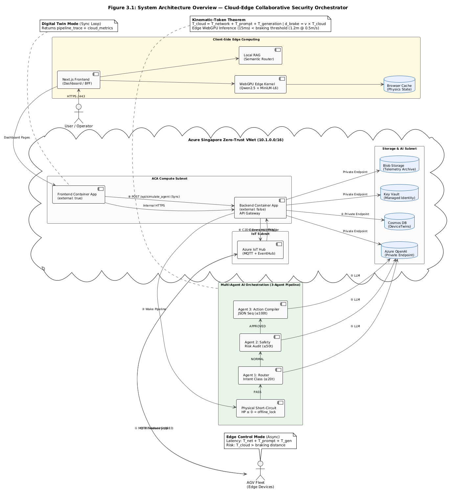
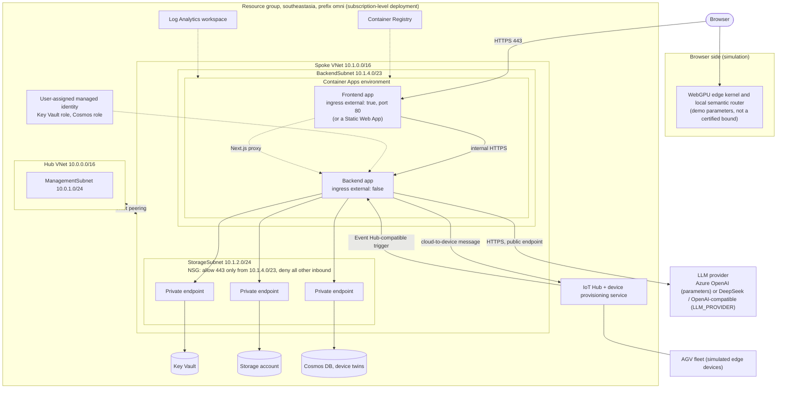
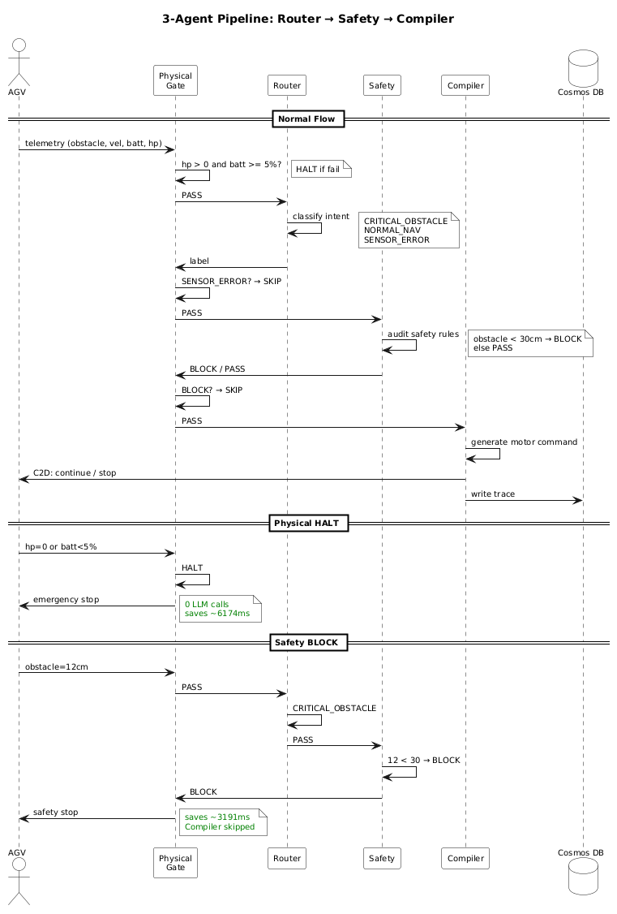

# Architecture diagrams

Three views of the Azure reference design, and how far each can be trusted. All three describe a **reference design for a simulation**; the cloud environment was deployed once for the thesis and has since been torn down, and nothing in this repository proves that a live environment exists.

| View | Source | Status |
|---|---|---|
| Thesis Figure 3.1, system architecture | restored unchanged from the thesis-era history (`docs/research_paper/architecture-figure-3.1.png`, last present before commit `3669792`) | historical figure, differs from the Bicep snapshot in details listed below |
| Reference topology (Mermaid, below) | drawn from `.azure/main.bicep`, `nested-infra.bicep`, `compute-module.bicep`, `network-rules.json` | follows the frozen Bicep snapshot |
| Thesis Figure 3.2, pipeline sequence | restored with its PlantUML source (`thesis-figure-3.2-sequence.puml`) | the original three-label pipeline; latency values are from the historical run |

## Thesis Figure 3.1: system architecture overview

What it shows: browser-side edge computing (Next.js dashboard as a front end and proxy, a WebGPU edge kernel and a local semantic router), a zero-trust VNet in Singapore with a compute subnet (frontend Container App external, backend Container App internal), a storage subnet behind private endpoints, an IoT subnet with IoT Hub, and the three-agent pipeline (physical short-circuit, Router, Safety, Compiler) in digital-twin (synchronous) and edge-control (asynchronous) modes.

How to read it today:

- The **WebGPU timings** (15 ms, 1.2 m at 0.5 m/s) and the Kinematic-Token relation are simulation parameters and a model, not measured results (see the [evidence policy](../evidence/README.md)).
- The figure draws Azure OpenAI behind a private endpoint in the storage subnet. The Bicep snapshot defines **three** private endpoints (Key Vault, Blob storage, Cosmos DB) and takes Azure OpenAI as parameters only (the key is stored as a Key Vault secret). The application now also supports DeepSeek and other OpenAI-compatible providers through `LLM_PROVIDER`, called over their public HTTPS endpoints.
- The figure draws IoT Hub in its own subnet; the Bicep snapshot creates IoT Hub and the device provisioning service without a subnet or private endpoint and passes their connection strings to the backend as secrets.
- The Router's "intent class (<= 20 tokens)" is the original three-label router. A six-route extended router exists as an opt-in tenant (see the [architecture document](../../ARCHITECTURE.md) section 4.2.1); this figure was not redrawn for it.
- Cosmos DB and IoT Hub are optional in the current code: the IoT trigger registers only when its connection string is set, and Cosmos failures do not stop the simulator.

## Reference topology as defined by the Bicep snapshot

Notes: the Bicep files are a frozen snapshot of the `secure-iot` preset from the separate Bicep Studio project (see [`.azure/README.md`](../../.azure/README.md)); edit them directly if the topology must change. The template's LLM parameters still describe Azure OpenAI; adapting it to another provider is not done. Hub-spoke peering, the two NSGs, three private endpoints with private DNS zones, a user-assigned managed identity with Key Vault and Cosmos role assignments, a container registry and a Log Analytics workspace are all in the snapshot.

## Thesis Figure 3.2: pipeline sequence

Source: [`thesis-figure-3.2-sequence.puml`](thesis-figure-3.2-sequence.puml). It shows the original three-label pipeline with its physical gate, the early exits and what each exit skips. The "saves about 6174 ms" and "about 3191 ms" notes come from the historical 200-run summary under that run's own definition; they are not re-measured and are not a latency guarantee (see the [benchmark results guide](../../src/cloud-orchestrator/embodied_brain/benchmark_results/README.md)).
