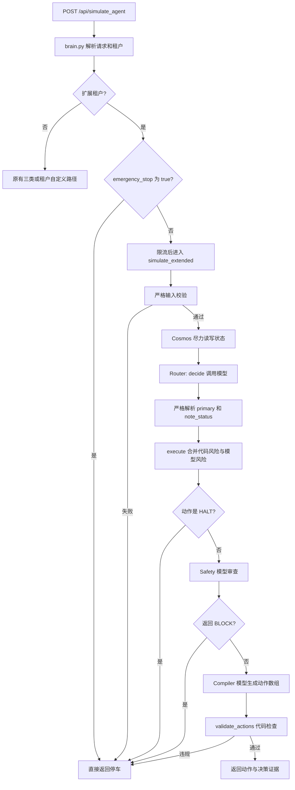

# 后端核心代码阅读地图（带中文备注）

更新：2026-11-08。按当前源码核对，仅作阅读说明，不修改冻结源码。先理解调用关系，再读细节。定位用文件、函数名和当前行号；后续代码改动时以函数名为准。

初次读代码，先看 [中文入门例子与字段表](START_HERE_zh.md)。本页反复出现的字段对应：`primary`＝主要状态，`risk_set`＝全部风险清单，`note_status`＝对备注的判断，`action`＝动作决定。例：障碍、过热、低电量同时存在，主要状态可只写障碍，但动作要保留停车、冷却要求和回充待办。

概念与架构取舍配套读 [Agent、意图与路由](AGENT_INTENT_DESIGN_zh.md)：本页讲代码在哪里，配套说明讲为何不能把状态类别数等同于 Agent 数。

## 1. 三个概念先分开

- **三个 Agent 角色**：Router 判断状态，Safety 再审规则，Compiler 生成动作。这是代码组织的顺序调用，不是三个模型自己讨论，也不是已训练的三个专用模型。
- **六类状态**：同一个 Router 从六个标签中输出一个主标签；可能同时存在多种风险，完整风险集由代码合成保留。
- **租户配置**：决定进入旧路径还是扩展路径。六类属于 `Tenant-Alpha-Extended`；`Tenant-Alpha` 仍是旧三类，`Tenant-Beta` 有另一套旧标签。六类不是从 Beta 那套标签直接拼出来的。

模型调用的作用，是根据提示词处理本次输入，不涉及本项目内的模型训练。多个角色默认可使用同一提供方与模型配置，区别主要在提示词、输入和输出用途。

## 2. 先看这张图



备注：图中的停车是服务返回的结构化决定，不是物理制动证明。急停在此处是**后端**前置处理，不是端侧硬件急停；接口限流也可能直接返回 429，不等于所有请求都会进入停车分支。

## 3. 核心文件按这个顺序读

| 顺序 | 文件与定位 | 带着什么问题看 | 中文备注 |
|---|---|---|---|
| 1 | [scenario_registry.json](../../src/cloud-orchestrator/scenario_registry.json) 的 `Tenant-Alpha-Extended` | 怎么选择新旧路径？ | `router_mode: extended` 是开关；这里的 `agent_router_prompt` 在扩展模式不用，真正提示词在 `router_v2/prompt.py`。不要只看注册表就认为已看完新 Router。 |
| 2 | [brain.py](../../src/cloud-orchestrator/embodied_brain/brain.py#L172) 的 `simulate_agent_endpoint()`，172–226 行 | 请求从哪进来？ | 读 JSON、查扩展配置；扩展急停在限流前返回；225–226 行把扩展租户交给 `simulate_extended()`。旧路径继续走后面的原有代码。 |
| 3 | [extended.py](../../src/cloud-orchestrator/embodied_brain/extended.py#L75) 的 `simulate_extended()` | 三个角色在哪里串起来？ | 这是扩展 HTTP 路径的总调度函数，先看它，不必先读整个仓库。输入检查、Cosmos、Router、Safety、Compiler、最终检查都在这里衔接。 |
| 4 | [pipeline.py](../../src/cloud-orchestrator/router_v2/pipeline.py#L122) 的 `decide()` | Router 一次判断具体做什么？ | 渲染输入→请求模型→检查结束原因→解析 JSON→交代码合成动作。一次调用输出两个字段，不是分别调用两个 Agent。 |
| 5 | [prompt.py](../../src/cloud-orchestrator/router_v2/prompt.py#L21) 的 `SYSTEM_PROMPT` | “识别六类”凭什么？ | 这里把六类定义、优先级、备注规则和输出格式告诉模型。标签是实验规范规定的，不是模型自动发现的。 |
| 6 | [rules.py](../../src/cloud-orchestrator/router_v2/rules.py#L17) 的 `THRESHOLDS`、`CLASSES`、`PRIORITY` | 代码如何独立核对？ | 阈值、类别、优先级的可执行定义；数值下限不靠模型自觉遵守。 |
| 7 | [rules.py](../../src/cloud-orchestrator/router_v2/rules.py#L181) 的 `execute()` | 模型错了，代码怎么处理？ | 重新计算遥测风险，合并模型主标签与备注风险；不可用回复停车。注意备注风险仍可能被模型漏判。 |
| 8 | [pipeline.py](../../src/cloud-orchestrator/router_v2/pipeline.py#L82) 的 `validate_actions()` | Compiler 说能走就能走吗？ | 不行，代码还查动作类型、速度、角度及 Router 约束。违规就返回停车。 |

第一次只读前五项，能画出一次请求如何流转，再读后三项理解执行约束。

## 4. “Agent 识别”到底发生在哪几行？

关键链路在 [pipeline.py](../../src/cloud-orchestrator/router_v2/pipeline.py#L122)：

```python
# 阅读摘录：省略了周围分支，不是可直接替代原函数的实现
user = R.render_telemetry(rec, clean_note)    # 129：数字和备注变成模型输入文本
reply = call_model(P.SYSTEM_PROMPT, user)    # 135：真正把本次输入交给模型
prediction, err = P.parse_reply(reply.content)  # 141：把回复读成两个合法字段
# 142：返回预测，并用 R.execute(...) 生成代码约束下的决策
```

`call_model` 的实际 API 请求在同文件 [openai_model_call()](../../src/cloud-orchestrator/router_v2/pipeline.py#L37) 的 42–43 行：`client.chat.completions.create(...)`。`model` 选择模型，`messages` 中 system 是工作规则、user 是本次遥测与备注。

区分三件事：**模型生成判断**发生在 API 服务；**解析**发生在 `parse_reply()`；**执行前的风险合成**发生在 `execute()`。解析出 JSON 不代表判断正确，动作被代码纠正也不代表原模型预测正确。

合法回复示意（不是正式测试样本）：

```json
{"primary":"CRITICAL_OBSTACLE","note_status":"AFFIRMED_CURRENT"}
```

没有备注时 `note_status` 必须是 `null`。有备注却给 `null`、多键、重复键、围栏或说明文字等会被拒绝；检查分布在 [parse_reply()](../../src/cloud-orchestrator/router_v2/prompt.py#L73) 与 [execute()](../../src/cloud-orchestrator/router_v2/rules.py#L200)。`decide()` 还要求 `finish_reason == "stop"`，截断回复不能当有效答案。

中文读法：`null` 是“没有填写”，本例因没有备注而留空；`finish_reason` 是服务结束回复的原因，`stop` 在这里表示正常结束，**不是车的停车动作**。程序另生成的 `{"action":"stop"}` 才表示停车命令。两处用了同一个英文词，含义不同。

## 5. 三个 Agent 怎么组合？

读 [extended.py](../../src/cloud-orchestrator/embodied_brain/extended.py#L113) 的 113–171 行：

| 角色 | 在哪里调用 | 接收什么 | 产出什么 | 下一步怎么用 |
|---|---|---|---|---|
| Router | 119 行 `decide(rec, note, call)` | 遥测、可选备注、B-1.0 提示词 | 原始预测与代码合成后的决策 | 取 `dec["primary"]` 和 `dec["action"]`；若 HALT，直接返回并跳过后两段 |
| Safety | 140 行 `ask_agent(...)` | 租户规则、执行主标签、遥测、读取的状态 | 文本，约定 `PASS` 或 `BLOCK: ...` | 142 行用 `startswith("BLOCK")` 判断是否拦截；拦截后不调用 Compiler |
| Compiler | 154 行 `ask_agent(...)` | schema、主标签、Safety 文本、遥测、速度约束 | JSON 动作数组 | `json.loads` 后交 `validate_actions()`；只有代码检查通过才返回 |

这里是**程序编排的串行流水线**：前一阶段的部分结果由 Python 填进后一阶段输入。没有角色投票、自动组队或多轮协商；也不是每次请求必然调用三次模型，停车与拦截会提前结束。

Safety 的文本判断没有 Router 那样严格的 JSON 契约；源码会把非 BLOCK 的其他文本带到后续。Compiler 还允许剥除代码围栏后解析。不要说三个角色的输出都经过完全相同的严格解析。

Router 调用明确使用 `no_retry_client(..., 60)`；Safety 和 Compiler 自 2026-11-21 起走 [bounded_agent.py](../../src/cloud-orchestrator/embodied_brain/bounded_agent.py)：一次请求、关闭重试、60 秒占位超时、无缓存，故障分类后停车；有假客户端测试和一次 84 条的真实可用性运行（见 [safety_compiler](../safety_compiler/README.md)）。原有 [utils.py 的 ask_agent()](../../src/cloud-orchestrator/embodied_brain/utils.py#L110)（SDK 默认值、5 秒进程内缓存）仍给旧租户用。不要把 Router 的测量口径直接推广到整条 HTTP 流程。

## 6. 六类怎么确认？先有定义，再有样本和验证

**六类是五种风险加正常状态，不是六个固定任务场景。** 来源与阈值理由见 [LABEL_SPEC.md](../spec/LABEL_SPEC.md) 第 3、6、9 节。下表的值都是仿真实验约定，不是工业标准。

| 状态 | 判定依据 | 核心代码 | 单独出现时的处置含义 |
|---|---|---|---|
| `NORMAL_NAV` | 没有任何风险 | `compose()` 147 行、`execute()` 222 行的兜底主标签 | 继续移动 |
| `CRITICAL_OBSTACLE` | 距离 < 30 cm；或备注被判为当前肯定/不确定 | `risk_set()` 77 行、`NOTE_RISK_STATUSES`、`note_effect()` | HALT |
| `OVERHEAT` | 温度 > 60℃ | `risk_set()` 79 行 | HALT，保留 COOL |
| `LOW_HEALTH` | 仿真 HP < 50 | `risk_set()` 81 行 | HALT，保留 LOCK；不代表故障诊断 |
| `LOW_BATTERY` | 电量 < 20% | `risk_set()` 83 行 | 目标 CHARGER；没有路径或到达验证 |
| `OVERSPEED` | 速度 > 2.5 m/s | `risk_set()` 85 行 | MOVE_LIMITED；最终动作速度不超过 250 cm/s，且还受请求目标速度限制 |

严格小于/大于意味着等号不违规：距离 30、温度 60、HP 50、电量 20、速度 2.5 都不因对应阈值触发风险。无效输入不属于第七类，在模型前拒绝。

六个便于手算的教学示例：从 `distance_cm=100, velocity_ms=1, hp=100, battery_pct=80, temperature_c=25` 且无备注开始。

| 改哪个字段？ | 应出现什么主类？ | 为什么？ |
|---|---|---|
| 不改 | NORMAL_NAV | 五种风险都没触发 |
| distance_cm 改 20 | CRITICAL_OBSTACLE | 20 < 30 |
| temperature_c 改 65 | OVERHEAT | 65 > 60 |
| hp 改 40 | LOW_HEALTH | 40 < 50 |
| battery_pct 改 15 | LOW_BATTERY | 15 < 20，但尚未触发 battery < 5 的门控 |
| velocity_ms 改 3 | OVERSPEED | 3 > 2.5 |

以上是教学示例，不是冻结测试输入。验证六类定义不是“让模型说了算”：规范规定答案，代码计算数值金标，备注状态经独立 AI 标注与复核；正式测试每类 50 条，在冻结后检验模型预测。见 [report.md](../report.md)。

## 7. 多风险并存怎么组合？

先读 [risk_set()](../../src/cloud-orchestrator/router_v2/rules.py#L73)，再读 [execute()](../../src/cloud-orchestrator/router_v2/rules.py#L213)，最后读 [resolve_action()](../../src/cloud-orchestrator/router_v2/rules.py#L110)。

```python
# execute() 的核心逻辑，变量的完整定义见源码
tele = risk_set(rec)                                      # 代码从数字算风险
risks = [r for r in PRIORITY if r in model or r in tele]    # 代码风险与模型风险合并
action = resolve_action(risks, g, estop)                   # 一次性合成动作状态
executed_primary = risks[0] if risks else "NORMAL_NAV"    # 主标签只是最高优先级的一个
```

优先级为：障碍 > 过热 > 低健康 > 低电量 > 超速。优先级是实验约定，**只选主标签，不删除其他风险**。

示意：距离 20 cm、温度 65℃、电量 15%，其余正常。即使模型只报障碍，代码仍保留过热和低电量。最终主要状态为障碍，运动决定 HALT（停车），`holds`（保留的限制）里有 COOL（冷却要求），`deferred`（后续待办）里有 RETURN_TO_CHARGE（回充）。这是一次合成后的决定，不是已经依次执行三个任务。不会同时发出“停车并立即移动去充电”的矛盾状态。

`compose()` 用遥测和给定备注状态生成参考标签；`execute()` 用模型预测合成实际决策。前者知道已标注的备注状态，后者只知道模型的备注判断，不能认为代码能独立发现所有备注风险。

`gate()` 在 HP≤0 或电量<5 时给出 SKIP 门控状态；冻结的 `decide()`（评测测的函数）仍会先请求模型、再由 `execute()` 应用门控；自 2026-11-21 起，HTTP 流程（`extended.py`）在请求模型之前先判 gate，所以 gate 为 SKIP 的请求不会产生模型请求，`gate()` 的注释在 HTTP 流程里成立，在 `decide()` 里仍不成立。

## 8. 想核实行为，读哪些测试？

| 要确认的事 | 测试位置 | 备注 |
|---|---|---|
| 后端规则与评测规范相同 | [test_router_v2.py](../../tests/test_router_v2.py#L29) | 规则文件字节一致；提示词及解析器等价性检查 |
| 后端决策与开发评测动作一致 | [test_router_v2.py](../../tests/test_router_v2.py#L52) | 用开发记录和多种模拟回复验证，不是新的一轮模型实测 |
| 模型不能解除数值风险 | [test_router_v2.py](../../tests/test_router_v2.py#L121) | 偏松预测仍受代码约束 |
| 急停与非法输入不触发外部服务 | [test_extended_endpoint.py](../../tests/test_extended_endpoint.py#L82) | HTTP 层测试，使用假依赖 |
| COOL、LOCK、充电目标保留 | [test_extended_endpoint.py](../../tests/test_extended_endpoint.py#L150) | 看返回结构，不能据此声称实际冷却或到达充电位 |
| Compiler 超速动作被拦下 | [test_extended_endpoint.py](../../tests/test_extended_endpoint.py#L185) | 最终动作检查是独立代码保障 |

不必先读完所有测试。每理解一个函数，就挑一个对应测试，看输入、假回复与断言，通常比只读实现更直观。

## 9. 最后再看提供方与计时

- [llm_provider.py](../../src/cloud-orchestrator/llm_provider.py#L70)：`resolve_llm_config()` 选配置，`create_llm_client()`（134 行）创建 Azure OpenAI 或 OpenAI 兼容客户端。先不读密钥文件，也不需要打印凭据。
- [function_app.py](../../src/cloud-orchestrator/function_app.py#L40)：把 `brain_router` 注册进 FastAPI；IoT 触发是另一条旧路径，不走本页扩展 HTTP 分支。
- [extended.py](../../src/cloud-orchestrator/embodied_brain/extended.py#L113)：`t1/t2/t3` 记录各阶段，`_respond()` 计算后端总耗时；它们不等于浏览器往返时间。完整口径见 [LATENCY_EVIDENCE.md](../LATENCY_EVIDENCE.md)。

读完后先试着回答：请求靠什么进入六类路径？模型真正调用在哪？模型说正常而距离只有 20 cm 会怎样？同时低电量和过热会不会立即去充电？能解释这四题，再继续读旧路径和云资源代码。

<a id="offline-lab"></a>

## 10. 免费实操：先预测，再运行，再解释

这是从旧设计长稿中保留并重新核对的实操内容，只调用真实的决策函数和假模型。它不经过HTTP端点、不读私有文件、不访问API，也不是新的模型评测。HTTP层的急停与零外部调用行为另看上表中的端点测试。

从仓库根目录运行。这里仅用Python标准库与项目规则代码；`python3` 换成已有环境的Python也可以。先遮住预期结果，对每个场景预测：会不会调用模型，最后允许移动还是停车，为什么？

```sh
python3 - <<'PY'
import json
import sys
sys.path.insert(0, 'src/cloud-orchestrator')
from router_v2.pipeline import ModelReply, decide, validate_actions

base = dict(distance_cm=100, velocity_ms=1, hp=100,
            battery_pct=80, temperature_c=25)

def run(name, rec, note=None, status=None, fault=None):
    calls = []
    def fake_model(system, user):
        calls.append(user)
        return ModelReply(
            content=json.dumps(dict(primary='NORMAL_NAV', note_status=status)),
            finish_reason='stop', fault=fault)
    result = decide(rec, note, fake_model)
    dec = result['executed']
    print(name, 'calls=', len(calls), 'motion=', dec['action']['motion'],
          'risks=', dec['risk_set'], 'reasons=', dec['action']['halt_reasons'])
    return result

multi = run('多风险但模型报正常',
            dict(base, distance_cm=20, temperature_c=65, battery_pct=15))
assert multi['executed']['action']['motion'] == 'HALT'
assert set(multi['executed']['risk_set']) == {
    'CRITICAL_OBSTACLE', 'OVERHEAT', 'LOW_BATTERY'}

note_miss = run('备注风险被模型漏读', base, '前方有人', 'IRRELEVANT')
assert note_miss['executed']['action']['motion'] == 'MOVE'
invalid = run('缺少健康值', {k: v for k, v in base.items() if k != 'hp'})
assert not invalid['model_called']
assert invalid['executed']['action']['motion'] == 'HALT'
failure = run('假模型报告超时', base, fault='TIMEOUT')
assert failure['executed']['action']['motion'] == 'HALT'
gated = run('HP为0的扩展Router', dict(base, hp=0))
assert gated['model_called']  # decide() 里门控在execute内应用，仍先请求模型；HTTP 流程在 extended.py 里先判 gate
assert gated['executed']['action']['motion'] == 'HALT'

violations = validate_actions([dict(action='move', speed=999)],
                              multi['executed']['action'], target_speed=50)
assert violations
print('Compiler违规动作：', violations)
PY
```

| 场景 | 预期 | 说明什么 |
|---|---|---|
| 多风险但模型报正常 | 调用一次，HALT，保留三个风险 | 数值风险由代码补回；模型原判断仍然错 |
| 只有备注报告有人，模型判无关并报正常 | 调用一次，MOVE | 这是特意构造的漏停反例，代码不能独立读懂备注 |
| 缺健康值 | 零模型调用，INVALID_INPUT并HALT | 严格输入校验在模型前 |
| 假模型报告超时 | 一次假调用，TIMEOUT并HALT | 验证故障处理，不是实际等待60秒的超时实验 |
| HP为0 | 调用一次后HALT | 证明扩展Router门控的实际顺序，不把旧注释当调用链 |
| 给停车决定配move speed=999 | 违规列表非空 | 动作验证函数拒绝矛盾指令；实际HTTP回退由端点负责 |

做完改变两个条件，再运行：把第一例温度改为60，过热风险应消失；把备注状态改成 `AFFIRMED_CURRENT`，第二例应转为HALT。解释哪一条规则改变了结果。最后关掉代码，用中文说出“模型判断→代码补风险→动作校验”的分工，就完成这次练习。
